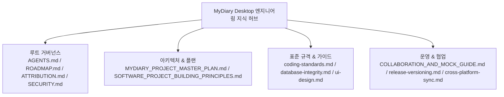

# 📚 MyDiary Desktop 공식 문서 체계 및 인덱스 (Documentation Hub)

> **문서 목적**: MyDiary Desktop 프로젝트의 설계 철학, 마스터 플랜, 협업 가이드, 배포 지침, 엔지니어링 표준을 체계화한 공식 통합 문서 허브(Sitemap)입니다.  
> **독자 대상**: 인간 개발자(`Sung Baekjin`), 공동개발자(`zigman1234`), 그리고 모든 AI 에이전트(Antigravity, Claude Code, Cursor, Copilot 등).  
> **최신 개정판**: 2026-10-19  
> **총괄 책임자**: 성백진 (`Sung Baekjin` / `sbjwin4271@gmail.com`)

---

## 🧭 통합 문서 계층 구조

MyDiary Desktop 프로젝트 문서는 단일 진실 공급원(SSOT) 원칙에 따라 모든 엔지니어링 지식을 `docs/` 및 프로젝트 루트에 표준화하여 관리합니다.

---

## 📑 핵심 문서 상세 인덱스

### 1. 마스터 거버넌스 & 로드맵 (Root)
* [AGENTS.md](file:///d:/development/mydiary-desktop/AGENTS.md): AI 에이전트 및 기여자를 위한 최상위 행동 헌장, 골든 룰, 세션 인계 가이드.
* [ROADMAP.md](file:///d:/development/mydiary-desktop/ROADMAP.md): 현재 버전 단계, 차원별 준비도(%), 에이전트-시간 추정 및 현재 집중 과제.
* [ATTRIBUTION.md](file:///d:/development/mydiary-desktop/ATTRIBUTION.md): 번들 에셋, 폰트, 아이콘 라이선스 및 인간/AI 공식 기여자 명시.
* [SECURITY.md](file:///d:/development/mydiary-desktop/SECURITY.md): 보안 정책, 취약점 보고 절차, 로컬 데이터 격리 및 Electron IPC 보안.

### 2. 아키텍처 & 설계 원칙
* [MYDIARY_PROJECT_MASTER_PLAN.md](file:///d:/development/mydiary-desktop/docs/MYDIARY_PROJECT_MASTER_PLAN.md): 프로젝트 전체 로드맵, 생명주기 관리, IPC 채널, 스토리지 스펙.
* [SOFTWARE_PROJECT_BUILDING_PRINCIPLES.md](file:///d:/development/mydiary-desktop/docs/SOFTWARE_PROJECT_BUILDING_PRINCIPLES.md): 범용 소프트웨어 구축 7대 원칙 (Fat Component 방어, SSOT, 서킷 브레이커 등).

### 3. 코딩 표준 & 도메인 규격
* [coding-standards.md](file:///d:/development/mydiary-desktop/docs/coding-standards.md): 순수 JS + @types, React 19, Context Isolation, HWPX XML 방어.
* [database-integrity.md](file:///d:/development/mydiary-desktop/docs/database-integrity.md): 모바일 JSON 1:1 호환, 데이터 유실 방지, Cascade Delete 무결성.
* [ui-design.md](file:///d:/development/mydiary-desktop/docs/ui-design.md): 와이드 데스크톱 3단 그리드, `src/theme.js` 디자인 토큰.

### 4. 협업 & 배포/릴리즈
* [COLLABORATION_AND_MOCK_GUIDE.md](file:///d:/development/mydiary-desktop/docs/COLLABORATION_AND_MOCK_GUIDE.md): GCP 키 없는 Zero-Config Mock 환경, GitHub 4대 업적 연계 Git 하네스.
* [release-versioning.md](file:///d:/development/mydiary-desktop/docs/release-versioning.md): 릴리즈 시 4대 일괄 동기화(package, README, HelpModal, 빌드 검증), Windows SAC 방어.
* [cross-platform-sync.md](file:///d:/development/mydiary-desktop/docs/cross-platform-sync.md): 스마트폰(`mydiary`)과 데스크톱(`mydiary-desktop`) 간 양방향 연동 원칙.
* [WINDOWS_SMARTSCREEN_TEST_GUIDE.md](file:///d:/development/mydiary-desktop/docs/WINDOWS_SMARTSCREEN_TEST_GUIDE.md): Windows 11 SmartScreen 무서명 배포 및 설치 검증 가이드.
