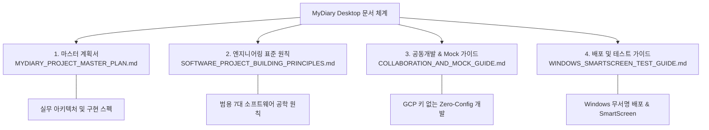

# 📚 MyDiary Desktop 공식 문서 체계 및 인덱스 (Documentation Index)

> **문서 목적**: MyDiary Desktop 프로젝트의 설계 철학, 마스터 플랜, 협업 가이드, 배포 지침을 체계화한 공식 문서 인덱스(Sitemap)입니다.  
> **최신 개정판**: 2026-10-17  
> **총괄 책임자**: 성백진 (`Sung Baekjin` / `sbjwin4271@gmail.com`)

---

## 🧭 문서 계층 구조 및 독자별 가이드

MyDiary Desktop 프로젝트 문서는 **"목적과 독자(Target Audience)"**에 따라 상호 보완적인 4대 핵심 체계로 구성되어 있습니다.

---

## 📑 핵심 문서 상세 안내

### 1. [MYDIARY_PROJECT_MASTER_PLAN.md](file:///d:/development/mydiary-desktop/docs/MYDIARY_PROJECT_MASTER_PLAN.md)
* **주요 내용**: 프로젝트 전체 로드맵, 런타임 수명주기(`requestSingleInstanceLock`, 창 위치 기억), 보안 아키텍처(Preload 화이트리스트 IPC), 로컬 DB 및 모바일 백업 호환 스펙.
* **추천 대상**: 프로젝트의 전체적인 아키텍처 흐름과 구현 상세를 깊이 있게 파악하려는 엔지니어.

### 2. [SOFTWARE_PROJECT_BUILDING_PRINCIPLES.md](file:///d:/development/mydiary-desktop/docs/SOFTWARE_PROJECT_BUILDING_PRINCIPLES.md)
* **주요 내용**: 데스크톱·웹·모바일을 아우르는 **범용 소프트웨어 구축 7대 원칙**.
  - 관심사의 분리 (Fat Component 방어)
  - 단일 진실 공급원(SSOT) 및 인앱 다이얼로그 100% 원칙
  - 스키마 어댑터 패턴 (Schema Adapter)
  - AI 에이전트 거버넌스 및 서킷 브레이커(Circuit Breaker)
* **추천 대상**: 유지보수성과 확장성이 뛰어난 소프트웨어 설계 방법론을 학습하고 검증하려는 개발자.

### 3. [COLLABORATION_AND_MOCK_GUIDE.md](file:///d:/development/mydiary-desktop/docs/COLLABORATION_AND_MOCK_GUIDE.md) *(신설)*
* **주요 내용**: GCP(Google Cloud) 키 없이도 누구나 즉시 전체 기능을 테스트할 수 있는 **Zero-Config Mock 환경 안내**.
  - 로컬 가상 구글 드라이브 스토리지(`@mydiary:mock_cloud_storage`) 구조
  - 원클릭 테스트 샘플 데이터 Seeder(`seedMockData`)
  - GitHub 4대 업적 뱃지 연계 Git 하네스(`zigman1234` Co-author 워크플로우)
* **추천 대상**: 프로젝트에 새로 합류한 공동개발자, 오픈소스 기여자, 빠른 UI/UX 테스트를 진행하려는 테스터.

### 4. [WINDOWS_SMARTSCREEN_TEST_GUIDE.md](file:///d:/development/mydiary-desktop/docs/WINDOWS_SMARTSCREEN_TEST_GUIDE.md)
* **주요 내용**: Windows 11 Smart App Control(SAC) 환경에서 자체 서명(Self-Signed) 인증서가 유발하는 영구 차단 결함을 회피하고, **표준 무서명 인스톨러**로 안전하게 패키징 및 배포하는 테스트 가이드.
* **추천 대상**: Windows 설치 프로그램 패키징 및 릴리즈 담당자.

---

## 🤖 AI 에이전트 하네스와의 연결고리

이 문서 체계(`docs/`)는 인간 개발자를 위한 것이며, AI 에이전트(Antigravity 등)는 [`.agents/AGENTS.md`](file:///d:/development/mydiary-desktop/.agents/AGENTS.md) 및 [`.agents/rules/`](file:///d:/development/mydiary-desktop/.agents/rules)를 통해 위의 원칙들을 기계적으로 준수하도록 강제됩니다.
