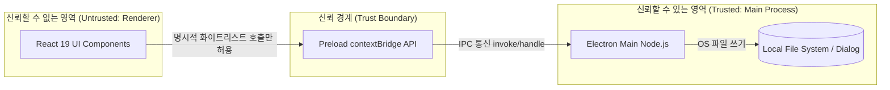
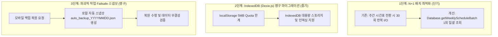
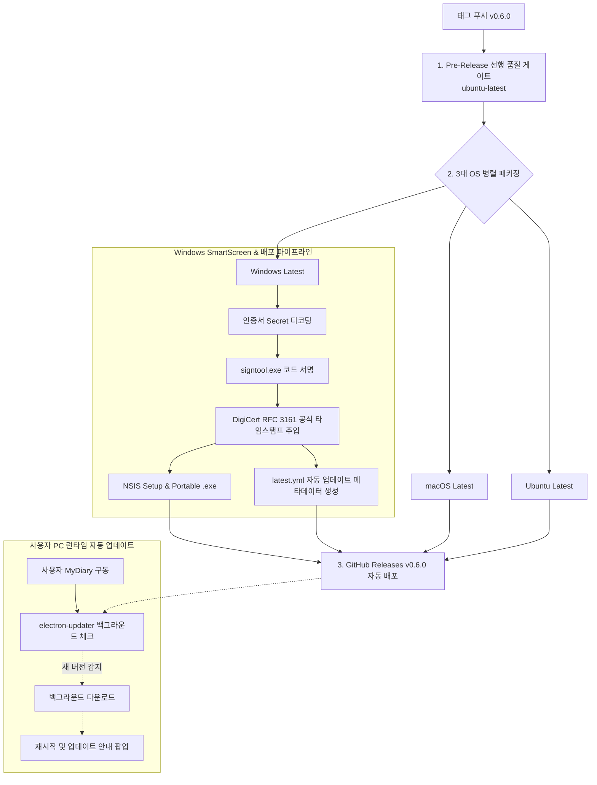
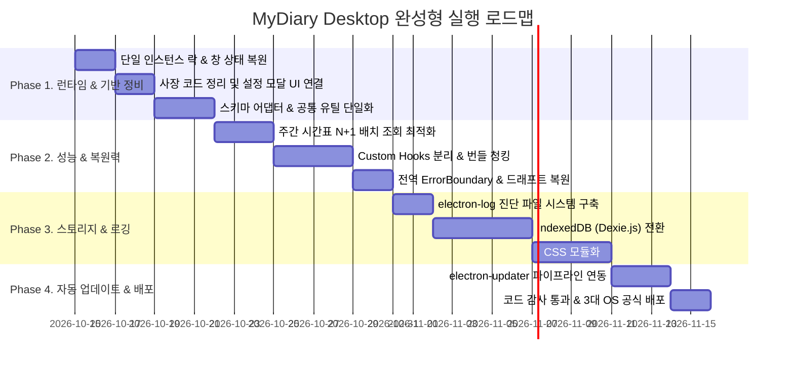

# 📘 MyDiary Desktop 마스터 계획서 (Rev 2.1 - Production Completeness Edition)

> **문서 개정판 (Doc Revision)**: Rev 2.1 (Full Production Completeness)  
> **현재 프로젝트 앱 버전**: v0.5.1 (기준: package.json)  
> **수립 및 최종 보강 일자**: 2026-10-19  
> **개발자**: 성백진 (`Sung Baekjin` / `sbjwin4271@gmail.com`)  
> **적용 표준**: 범용 7대 소프트웨어 엔지니어링 원칙 + 데스크톱 실무 운영 6대 핵심 스펙

---

## 🧭 표준 엔지니어링 원칙 및 데스크톱 실무 매핑 매트릭스

| 영역 | 표준 엔지니어링 원칙 | MyDiary Desktop 실무 적용 설계 | 핵심 산출물 및 관리 대상 |
| :--- | :--- | :--- | :--- |
| **1. 런타임 수명주기** | 문제 정의 & 단일 인스턴스 보장 | 중복 실행 방지(`requestSingleInstanceLock`), 창 크기/위치 복원 | `electron/main.js`, `window-state.json` |
| **2. 프로세스 격리** | 신뢰 경계(Trust Boundary) 및 보안 | Preload 화이트리스트 IPC, 외부 링크 시스템 브라우저 위임 | `electron/preload.js`, CSP 메타 태그 |
| **3. 프론트엔드 모듈화** | 계층 분리 & 스키마 어댑터 | Fat 컴포넌트 해체(Custom Hooks), 모바일-데스크톱 DTO 정규화 | `src/hooks/`, `src/utils/schemaAdapter.js` |
| **4. 데이터 영속 계층** | 스토리지 한계 & 장애 방어 | LocalStorage 5MB 극복 3단계 마이그레이션(배치 $\rightarrow$ IndexedDB), 복원 전 스냅샷 | `src/database/Database.js`, auto_backup.json |
| **5. 성능 & 복원력** | 청킹 최적화 & 런타임 세이프가드 | `React.lazy` 번들 분할(200kB 이하), 전역 `<ErrorBoundary>` 드래프트 복원 | `App.jsx`, Dynamic `import()`, ErrorBoundary |
| **6. 진단 & 로깅** | 유지보수성 & 결함 추적성 | 파일 기반 일자별 롤링 로그(`electron-log`), 설정창 로그 내보내기 | `%APPDATA%/MyDiary/logs/`, SettingsModal |
| **7. AI 거버넌스** | 하네스 & 서킷 브레이커 | R-O-C-K 헌장, 최대 2회 루프 차단, AST/정규식 기반 코드 감사 | `.agents/AGENTS.md`, `run-code-audit.cjs` |
| **8. Git 버전 관리** | 커밋 컨벤션 & SSOT 릴리즈 | 100% 한국어 커밋 원칙, `package.json` 단일 소스 기반 4대 동기화 | `scripts/sync-readme-version.js` |
| **9. 배포 & 자동 업데이트**| 선행 품질 게이트 & 무중단 패치 | GitHub Actions 3대 OS 병렬 패키징, RFC 3161 타임스탬프, `electron-updater` | `.github/workflows/`, GitHub Releases |

---

## 1. [신규 보강] 데스크톱 런타임 수명주기 및 창 상태 관리 (Runtime Lifecycle)

### 1-1. 단일 인스턴스 락 (Single Instance Lock)
* **문제점**: 사용자가 바탕화면 아이콘을 연타하거나 여러 번 실행 시 독립된 앱 프로세스가 중복 기동되어 로컬 스토리지에 동시 쓰기가 발생, 데이터가 덮어씌워지거나 파괴됨.
* **해결 설계 (`electron/main.js`)**:
  ```javascript
  const gotTheLock = app.requestSingleInstanceLock();
  if (!gotTheLock) {
    app.quit(); // 두 번째 실행된 프로세스는 즉시 종료
  } else {
    app.on('second-instance', () => {
      // 이미 실행 중인 기존 창을 찾아 화면 앞으로 포커스
      if (mainWindow) {
        if (mainWindow.isMinimized()) mainWindow.restore();
        mainWindow.focus();
      }
    });
  }
  ```

### 1-2. 창 크기 및 위치 상태 기억 (Window State Persistence)
* **문제점**: 교사가 창을 최대화(Maximize)하거나 듀얼 모니터의 특정 위치로 조정한 뒤 앱을 종료하면 다음 기동 시 기본 크기(1360x880)로 리셋되어 사용자 경험 저하.
* **해결 설계**:
  - 사용자 데이터 경로(`app.getPath('userData')/window-state.json`)에 종료 시점의 `x`, `y`, `width`, `height`, `isMaximized` 저장.
  - 앱 시작 시 해당 위치가 현재 연결된 모니터 영역 내에 유효한지 검증 후 복원.

---

## 2. 보안 아키텍처 및 샌드박스 설계 (Security Baseline)



* `nodeIntegration: false`, `contextIsolation: true` 강제.
* 외부 링크(`http`, `https`, `mailto`) 클릭 시 내부 창에서 열리지 않고 시스템 기본 브라우저로 안전하게 위임 (`shell.openExternal`).
* 엄격한 Content Security Policy(CSP) 메타 태그 선언으로 인라인 스크립트 인젝션 차단.

---

## 3. 프론트엔드 계층 분리 및 스키마 어댑터 (Frontend & Schema)

### 3-1. Fat 컴포넌트 해체 (Custom Hooks 추출)
* `WeeklyScheduleTab.jsx` $\rightarrow$ 순수 매트릭스 뷰 + `useWeeklySchedule.js`
* `StudentManageTab.jsx` $\rightarrow$ 순수 학생 테이블 뷰 + `useStudents.js`
* `ClassDiaryTab.jsx` $\rightarrow$ 순수 일지 폼 뷰 + `useClassDiary.js`
* `BackupSettingTab.jsx` $\rightarrow$ 백업 UI 뷰 + `useBackupSync.js`

### 3-2. 스키마 어댑터 (`src/utils/schemaAdapter.js`)
* 모바일 백업 JSON(`student_id`, `school_grade`)과 데스크톱 컴포넌트(`studentId`, `grade`) 간의 다중 fallback(`||`) 연산자를 제거하고 입출구에서 100% 표준 DTO로 상호 변환.

### 3-3. 공통 유틸리티 통합 (중복 0%)
* `src/utils/fileDownloader.js`: Electron Native File Dialog 및 Web Blob 다운로드 분기 단일화.
* `src/utils/phoneUtils.js`: 전화번호 정규화 단일화.
* `src/utils/xmlUtils.js`: HWPX/DOCX XML 이스케이프 단일화.
* `src/utils/dialog.js`: `showToast`, `showConfirm` 전역 이벤트 시스템으로 모든 탭의 자체 모달 통합.

---

## 4. 스토리지 엔진 혁신 및 데이터 무결성 (Storage & Migration)



---

## 5. 성능 최적화 및 런타임 복원력 (Performance & Resilience)

1. **React.lazy 및 Dynamic Import**:
   - `SettingsModal`, `HelpModal`, `ScheduleModal` 지연 로딩.
   - `jszip`, `docx-preview`, `HwpxExportService`를 내보내기 클릭 시점에 동적 로드 $\rightarrow$ **초기 번들 크기 640kB에서 200kB 이하로 경량화**.
2. **전역 `<ErrorBoundary>` 및 임시 드래프트 복원**:
   - React 19 렌더링 예외 발생 시 화면 백지화 방지 및 복구 UI 노출.
   - 일지 작성 폼 입력 시 5초 주기로 `_diary_temp_draft`에 자동 저장되어 크래시 후 재기동 시 원클릭 복구.

---

## 6. [신규 보강] 애플리케이션 진단 로깅 및 디버그 지원 (Diagnostics & Logging)

* **문제점**: 프로덕션 배포 시 개발자 도구(F12)가 비활성화되어, 사용자가 "PDF 저장이 안 돼요", "구글 로그인이 안 돼요"라고 문의 시 원인 파악 불가능.
* **해결 설계**:
  1. **`electron-log` 도입**: 메인 프로세스 및 렌더러 프로세스의 로그를 로컬 파일(`%APPDATA%/MyDiary/logs/main.log`)에 일자별(최대 7일 롤링) 저장.
  2. **환경설정 모달 진단 버튼 제공**:
     - `SettingsModal.jsx`에 **[진단 로그 폴더 열기]** 및 **[오류 로그 복사]** 버튼 신설.
     - 사용자가 개발자(`sbjwin4271@gmail.com`)에게 원클릭으로 로그를 첨부하여 보낼 수 있도록 지원.

---

## 7. 엔지니어링 & AI 거버넌스 하네스 (Harness & Circuit Breaker)

* **R-O-C-K 거버넌스 헌장 ([.agents/AGENTS.md](../.agents/AGENTS.md))**:
  - 순수 JS + `@types` 유지, 개발자 정보(성백진) 고정, 100% 한국어 커밋.
* **서킷 브레이커 (Circuit Breaker)**:
  - 동일 원인의 빌드/테스트 에러 자동 수정 시도는 **최대 2회**로 제한.
* **정적 코드 감사 하네스 (`npm run audit`)**:
  - `scripts/run-code-audit.cjs`로 중복 함수, 하드코딩 색상, 사장 코드(`StorageService.js`) 자동 탐지.

---

## 8. Git 버전 관리 및 100% 한국어 커밋 전략 (Git & SSOT)

* **커밋 메시지 원칙**: 100% 순수 한국어로만 작성 (`<태그>: <한국어 요약>`).
* **4대 일괄 동기화 트랜잭션**:
  - `package.json`의 버전을 단일 소스로 `README.md`, `HelpModal.jsx`, 번들 검증을 `scripts/sync-readme-version.js`로 동시 동기화.

---

## 9. [신규 보강] CI/CD 배포 및 자동 업데이트 파이프라인 (Auto-Updater & SmartScreen)



### 9-1. 자동 업데이트 (`electron-updater`) 구현 지침
* 앱 기동 시 GitHub Releases 저장소(`sbjwin/mydiary-desktop`)를 주기적으로 확인.
* 새 버전 바이너리가 감지되면 백그라운드에서 다운로드 후 "새 버전이 준비되었습니다. 지금 재시작하여 업데이트하시겠습니까?" 대화상자 노출.

### 9-2. Windows SmartScreen 방어 전략
* DigiCert RFC 3161 타임스탬프 주입으로 인증서 만료 후 영구 유효성 유지.
* 자가 서명 인증서 배포 시 원클릭 등록 스크립트(`certs/install-cert.bat`) 제공.

---

## 10. [신규 보강] 키보드 단축키 및 접근성 표준 맵 (Keyboard Accessibility)

| 단축키 (Windows/Linux) | 단축키 (macOS) | 대상 기능 | 비고 |
| :--- | :--- | :--- | :--- |
| `Ctrl + ,` | `Cmd + ,` | 환경설정 모달 열기 | `Header.jsx` 및 전역 이벤트 연결 |
| `F1` | `F1` | 사용 가이드 및 도움말 모달 열기 | Electron 어플리케이션 메뉴 연동 |
| `Ctrl + S` | `Cmd + S` | 현재 작성 중인 일지 즉시 저장 | 작성 폼 포커스 시 동작 |
| `Ctrl + P` | `Cmd + P` | 인쇄 미리보기 창 열기 | 주간시간표 / 일지 탭 |
| `Escape` | `Escape` | 열려 있는 모든 모달 닫기 및 포커스 복원 | `useModal` 공통 훅 처리 |
| `F11` | `Ctrl + Cmd + F` | 전체 화면 토글 | Electron 메인 메뉴 처리 |

---

## 11. 종합 실행 마일스톤 및 완료 기준 (Definition of Done)



### 최종 완료 기준 (DoD)
1. **런타임 무결성**: 중복 실행 차단 및 종료 시 창 위치/크기 완벽 복원.
2. **코드 무결성**: AST 감사(`npm run audit`) 위반 0건, 다중 fallback 연산자 0건.
3. **성능 & 복원력**: 주간 시간표 I/O 1회 배치화, 번들 청크 < 200kB, 크래시 시 드래프트 복구.
4. **스토리지**: 5MB LocalStorage 한계 완전 해소, 복원 전 자동 스냅샷 생성.
5. **진단 & 배포**: 설정 모달에서 진단 로그 폴더 열기 지원, GitHub Actions를 통한 3대 OS 공식 릴리즈 및 클라이언트 자동 업데이트 통과.
