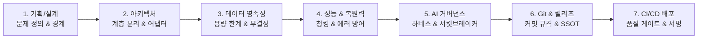
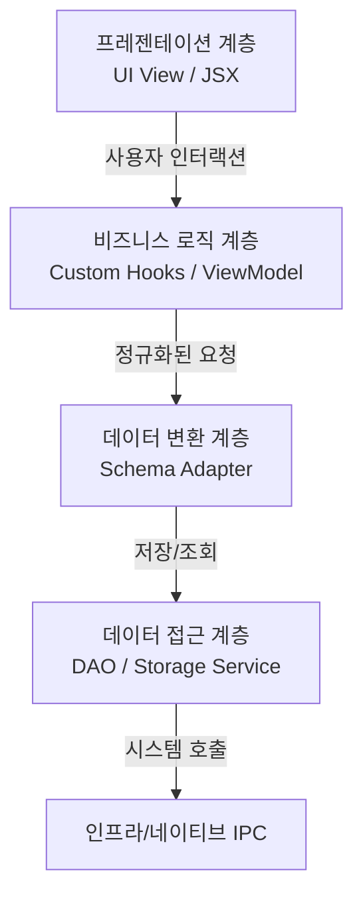

# 🎓 범용 소프트웨어 프로젝트 구축 표준 원칙 및 엔지니어링 가이드 (Study Guide)

> **문서 목적**: 특정 도메인(MyDiary)을 넘어, 웹·모바일·데스크톱 등 모든 현대적 소프트웨어 개발 프로젝트에 보편적으로 적용할 수 있는 **엔드투엔드(End-to-End) 프로젝트 구축 원칙과 아키텍처 방법론**을 학습용 프레임워크로 체계화합니다.

---

## 🧭 프로젝트 생애주기 7대 핵심 프레임워크

---

## 1. 프로젝트 기획 및 설계 원칙 (Planning & Boundary)

### 1-1. '기능 나열'이 아닌 '핵심 가치와 제약 조건' 중심 기획
* **일반적 오류**: "학생 목록 보여주기", "달력 만들기"처럼 단순 화면 단위 기능만 나열하면 개발 도중 아키텍처가 흔들립니다.
* **표준 원칙**:
  1. **가치 제안(Core Value)** 명확화: 우리 앱이 다른 솔루션과 차별화되는 결정적 가치 1~2개(예: 로컬 데이터 주권, 국가 표준 서식 보존)를 맨 앞에 정의합니다.
  2. **환경적 제약(Constraints)** 식별: "오프라인에서도 동작해야 하는가?", "공공기관 PC의 보안 정책을 만족해야 하는가?" 등 타협할 수 없는 경계를 먼저 긋습니다.

### 1-2. 보안 모델과 신뢰 경계(Trust Boundary) 선행 설계
* 백엔드 API든 데스크톱 런타임(Electron)이든, **신뢰할 수 없는 영역(Untrusted/UI)**과 **권한이 있는 영역(Trusted/System/DB)**의 경계를 분리합니다.
* **최소 권한의 원칙 (Least Privilege)**: UI 계층이 직접 파일 시스템이나 시스템 커맨드를 호출하지 못하게 하고, 엄격한 화이트리스트 API(Preload / RPC)를 통해서만 소통하도록 강제합니다.

---

## 2. 소프트웨어 아키텍처 및 계층 분리 원칙 (Architecture)

### 2-1. 관심사의 분리 (Separation of Concerns)
컴포넌트 하나에 모든 것을 몰아넣는 **"Fat Component / God Object"** 안티패턴을 피해야 합니다.

* **UI View**: 데이터를 어떻게 보여줄지만 고민 (로직 0%).
* **Custom Hooks / Controllers**: 상태 관리, 유효성 검증, 뷰 라이프사이클 제어.
* **Schema Adapter**: 외부 데이터(레거시 스키마, 모바일 백업, 서드파티 API)와 내부 표준 모델 사이의 완충 지대.
* **Storage / Services**: 영속성 입출력 및 외부 통신 전담.

### 2-2. 스키마 어댑터 패턴 (Schema Adapter Pattern)
외부 데이터 모델(`snake_case`, 레거시 필드명)과 내부 코드(`camelCase`, 표준 필드명)가 뒤섞이면 코드 전체에 `rec.user_id || rec.userId` 같은 다중 fallback 연산자가 증식합니다.
* **원칙**: 시스템 입구(인입 시)에서 표준 DTO로 100% 정규화하고, 시스템 출구(내보낼 때)에서 목적지 규격으로 직렬화하는 어댑터를 둡니다.

---

## 3. 데이터 영속성 및 확장성 원칙 (Storage & Scalability)

### 3-1. 프로토타입 스토리지의 함정 인지 (Storage Quota)
* 초기 개발 시 `localStorage`나 단순 JSON 파일 저장은 매우 편리합니다.
* 하지만 실제 사용자가 데이터를 6개월~1년 이상 누적하면 **용량 초과(`QuotaExceededError`)** 또는 직렬화 비용으로 인한 UI 프리징이 발생합니다.
* **원칙**:
  - 초기 단계: 캐시 계층 도입 및 불필요한 반복 디스크 쓰기를 막는 **Debounce/Batch 로드** 적용.
  - 성장 단계: 인덱싱과 비동기 대용량 처리를 지원하는 표준 DB(`IndexedDB`, `SQLite`, `PostgreSQL`)로의 **마이그레이션 경로를 기획 단계에서 미리 수립**.

### 3-2. 안전망 중심의 복원(Restore) 트랜잭션
* 사용자가 백업 데이터를 복원하거나 대규모 변경을 가할 때, 네트워크 단절이나 파일 깨짐이 발생하면 데이터가 통째로 증발할 수 있습니다.
* **원칙 (Failsafe Snapshot)**: 파괴적인 작업(복원, 대량 삭제) 직전에는 반드시 **"현재 상태의 자동 스냅샷(Auto-Snapshot)"**을 먼저 로컬에 남겨두고 본 작업을 수행합니다.

---

## 4. 프론트엔드 성능 및 복원력 원칙 (Performance & Resilience)

### 4-1. 번들 청킹 및 지연 로딩 (Code Splitting)
* 사용자가 앱을 켰을 때 모든 기능(설정창, 도움말, 대형 엑셀/한글 생성 엔진)을 첫 화면에서 한 번에 다운로드/파싱할 필요가 없습니다.
* **원칙**:
  - 초기 화면에 즉시 필요한 자원만 1차 번들(목표: 200kB 이하)로 패키징.
  - 모달, 복잡한 리포트, 무거운 외부 라이브러리는 `React.lazy` 및 Dynamic `import()`로 사용자가 클릭하는 순간 로드.

### 4-2. 런타임 오류 방어막: 전역 에러 바운더리 (Error Boundary)
* 프론트엔드 프레임워크(React 등)는 하위 렌더링 중 예외가 발생하면 전체 화면을 언마운트하여 백지(Whiteout)를 만듭니다.
* **원칙**:
  - 최상위 및 기능 단위별로 `<ErrorBoundary>`를 설치.
  - 앱이 완전히 죽는 대신 "오류 안내 화면"을 띄우고, **작성 중이던 텍스트(Draft)를 로컬 임시 스토리지에서 즉시 파일로 구출할 수 있는 버튼**을 제공합니다.

---

## 5. 엔지니어링 & AI 거버넌스 하네스 설계 (Harness)

AI 코딩 어시스턴트나 팀 개발자가 코드를 수정할 때 발생할 수 있는 안티패턴과 무한 루프를 방어하는 통제 시스템입니다.

### 5-1. R-O-C-K 거버넌스 프레임워크
| 요소 | 의미 | 실무 적용 방법 |
| :--- | :--- | :--- |
| **[R] Role** | 에이전트의 역할과 정체성 | "아키텍처를 독단으로 파괴하지 않고 기존 설계를 보조하는 엔지니어" |
| **[O] Objectives** | 프로젝트 최우선 목표 | "데이터 무결성, 크로스플랫폼 무결점 빌드, 서식 보존" |
| **[C] Constraints** | 타협할 수 없는 제약 | "순수 JS 유지, 100% 한국어 커밋, 서킷 브레이커(최대 2회 시도)" |
| **[K] Knowledge** | 도메인 지식 및 도구 | "코딩 규칙, 릴리즈 프로세스, 자동 감사 스크립트" |

### 5-2. 서킷 브레이커 (Circuit Breaker)
* 테스트나 빌드가 실패했을 때 AI나 자동 스크립트가 스스로 고치겠다며 무한히 코드를 바꾸다 프로젝트를 파괴하는 현상을 방지합니다.
* **동일 원인에 대한 자동 시도는 최대 2회**로 제한하고, 해결되지 않으면 즉시 멈추고 인간 엔지니어에게 상태를 보고합니다.

### 5-3. 정적 코드 감사 하네스 (Audit Harness)
* 코드 리뷰나 CI 단계에서 `npm run audit` 같은 커스텀 감사 스크립트를 실행하여 다음을 사전 차단:
  - 중복 유틸리티 함수 선언.
  - 하드코딩된 색상/스타일 (디자인 토큰 우회).
  - 스키마 fallback 남용 및 사장된 고스트 파일(Dead Code).

---

## 6. Git 버전 관리 및 협업 문화 원칙 (Git & Release)

### 6-1. 명확한 커밋 컨벤션 (Conventional Commits)
* 커밋 메시지는 미래의 나와 팀원을 위한 **'의도와 맥락의 기록'**입니다.
* 일관된 언어(예: 100% 한국어)와 태그(`feat`, `fix`, `refactor`, `perf`, `docs`, `chore`)를 강제하여 커밋 히스토리만 보고도 변경 흐름을 파악할 수 있게 합니다.

### 6-2. 단일 진실 공급원(SSOT) 기반의 4대 릴리즈 동기화
* 버전 번호가 소스코드, 설정 파일, 설명서, UI에 제각각 흩어져 있으면 릴리즈 시 반드시 누락 사고가 납니다.
* **원칙**: 릴리즈 시 `package.json`의 버전을 단일 소스로 하여 `README`, `UI 모달`, `빌드 검증`을 **단일 트랜잭션으로 일괄 동기화**합니다.

---

## 7. CI/CD 자동화 파이프라인 원칙 (Continuous Delivery)

### 7-1. 선행 품질 게이트 (Pre-Release Quality Gate)
* 패키징이나 배포에 들어가기 전, 가장 가벼운 환경(`ubuntu-latest`)에서 **린트, 코드 감사, 단위 테스트, 프로덕션 번들링**을 먼저 통과해야만 실제 OS별 빌드 작업을 가동합니다.
* 이를 통해 무거운 매트릭스 빌드 자원의 낭비를 막습니다.

### 7-2. 크로스플랫폼 병렬 빌드 및 보안 서명 (Code Signing)
* 운영체제별 빌드(Windows, macOS, Linux)는 독립된 러너에서 병렬(`matrix`)로 실행합니다.
* **Windows 배포 시 필수**: 코드 서명(Code Signing) 시 반드시 공인 타임스탬프(RFC 3161)를 주입해야 인증서가 만료된 후에도 바이너리가 정상 실행되며 SmartScreen 경고를 줄일 수 있습니다.

---

## 💡 요약: 성공적인 프로젝트 구축 체크리스트

1. [ ] **설계**: 사용자에게 제공할 단 하나의 '대체 불가능한 핵심 가치'가 정의되어 있는가?
2. [ ] **아키텍처**: 비즈니스 로직과 UI 뷰가 완벽히 분리되어 있는가? (Custom Hooks / 어댑터)
3. [ ] **데이터**: 1년 뒤 데이터가 10배로 늘어나도 스토리지가 버틸 수 있는가?
4. [ ] **복원력**: 런타임 오류가 났을 때 작성 중이던 작업물이 보존되는가?
5. [ ] **거버넌스**: AI나 협업자가 코드를 망치지 못하도록 제약 조건(하네스)이 걸려 있는가?
6. [ ] **버전 관리**: 커밋 메시지만 봐도 프로젝트의 진화 과정이 투명하게 읽히는가?
7. [ ] **배포**: 코드 수정 후 원클릭 또는 태그 푸시만으로 무결점 빌드가 배포되는가?
